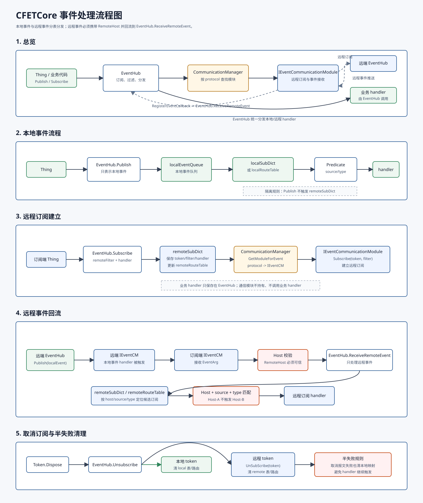

# CFETCore 事件处理总体设计

本文档用于明确 CFETCore 事件体系的总体处理流程，约束本地事件、远程事件、订阅分发、事件回流、主机路由和通信模块之间的职责边界。

# 背景问题
旧的本地事件模型大致是：

```
Thing -> MyHub.EventHub.Publish(...)
      -> EventHub 本地事件队列
      -> EventHub 遍历本地订阅
      -> EventFilter.Predicate(...)
      -> handler
```

远程订阅时，EventHub.Subscribe(...) 会把业务 handler 直接传给远程事件实现；远程事件到达后，由远程事件实现直接调用这个 handler。

```
Thing -> MyHub.EventHub.Subscribe(remoteFilter, handler)
      -> 远程事件实现保存 handler
      -> 远程事件到达
      -> 远程事件实现直接调用 handler
```

这样的设计问题是：

1. 这样的设计对于多个事件订阅者共享同一个远程事件实现时，无法共享同一个订阅，旧的设计也原本就是对于一个订阅开一个新的Socket，有些浪费；
2. 同时，远程事件实现直接调用业务 handler，没有走EventHub进行处理，这也是不合适的。

# 设计原则

1. `EventHub` 是事件语义层，负责订阅关系、过滤、分发、异常隔离和 Token 生命周期。
2. `IEventCommunicationModule` 是远程事件通信层，负责远程订阅、取消订阅、事件接收、连接状态和远端通信。
3. `IEventCommunicationModule` 通信模块不直接持有业务 handler，也不直接调用业务 handler。
4. 本地事件和远程事件使用不同的订阅表。
5. 本地事件只分发给本地订阅者。
6. 远程事件只分发给远程订阅者。
7. 远程事件必须携带来源 Host/Endpoint 信息，用于跨主机隔离。
8. 同名的本地事件和远程事件不能互相触发。
9. 同名但来自不同远程 Host 的事件不能互相触发。

核心约束：

```text
EventHub.Publish(...) 只处理本地事件。
EventHub.ReceiveRemoteEvent(...) 只处理远程事件。
本地订阅和远程订阅不能混用同一个分发表。
远程事件必须校验 Host 后才能触发远程订阅。
```

# 新总体设计

新的设计如下：

这样设计之后，所有的事件分发都在EventHub进行，且对于多个事件订阅者共享同一个远程事件实现时，可以共享同一个订阅。

```text
本地事件路径:

Thing
  -> MyHub.EventHub.Publish(eventArg)
  -> EventHub.localEventQueue
  -> EventHub.localSubDict 或本地路由表
  -> local subscriber handler


远程订阅路径:

Thing
  -> MyHub.EventHub.Subscribe(remoteFilter, handler)
  -> EventHub 判断 filter.Host 非空
  -> CommunicationManager.GetModuleForEvent(protocol)
  -> EventHub.remoteSubDict 保存 token/filter/handler
  -> IEventCommunicationModule.Subscribe(token, filter)


远程事件回流路径:

Remote EventHub
  -> 远端本地事件触发
  -> 远端 IEventCommunicationModule 的事件 handler 被调用
  -> 远端 IEventCommunicationModule 与订阅端 IEventCommunicationModule 通信
  -> 订阅端 IEventCommunicationModule 触发 RegisterEventCallback 注册的回调
  -> 订阅端 EventHub.ReceiveRemoteEvent(eventArg)
  -> 订阅端 EventHub.remoteSubDict 或远程路由表
  -> remote subscriber handler
```


远程事件本质上不是独立于本地事件之外的新事件类型，而是：

```text
订阅端订阅了远程端的本地事件。
```

事件最初仍然发生在远程端的本地 `EventHub` 中。完整链路如下：

```text
订阅端 Thing
  -> 订阅端 EventHub.Subscribe(remoteFilter, localHandler)
  -> 订阅端 EventHub 判断 filter.Host 非空
  -> 订阅端 CommunicationManager 找到订阅端 IEventCommunicationModule
  -> 订阅端 EventHub 保存 remoteSubDict[token.Id] = Subscriber(filter, localHandler)
  -> 订阅端 IEventCommunicationModule.Subscribe(token, filter)
  -> 订阅端 IEventCommunicationModule 与远端 IEventCommunicationModule 建立远程订阅

远端 Thing
  -> 远端 EventHub.Publish(localEvent)
  -> 远端 EventHub 匹配到远端 IEventCommunicationModule 注册的本地事件 handler
  -> 远端 IEventCommunicationModule 的 handler 被调用
  -> 远端 IEventCommunicationModule 将事件发送给订阅端 IEventCommunicationModule

订阅端 IEventCommunicationModule
  -> 接收到远端推送的 EventArg
  -> 补齐或校验 eventArg.Host
  -> 调用 RegisterEventCallback 中注册的回调
  -> 订阅端 EventHub.ReceiveRemoteEvent(eventArg)
  -> 订阅端 EventHub 只在 remoteSubDict 或远程路由表内分发
  -> 订阅端远程订阅者 localHandler 被调用
```

因此，“远程事件”在订阅端看来是远程事件；在事件产生端看来仍然是本地事件。中间的远程通信由事件通信模块处理。



## 订阅表设计

`EventHub` 内部维护两类订阅。

本地订阅表：

```text
localSubDict:
  Token.Id -> Subscriber(filter, handler)
```

远程订阅表：

```text
remoteSubDict:
  Token.Id -> Subscriber(filter, handler)
```

两张表的分发入口不同：

```text
Publish(eventArg)
  -> 只分发 localSubDict 或本地路由表

ReceiveRemoteEvent(eventArg)
  -> 只分发 remoteSubDict 或远程路由表
```

不要让 `Publish(...)` 分发 `remoteSubDict`，也不要让 `ReceiveRemoteEvent(...)` 分发 `localSubDict`。

远程事件eventArg必须携带明确的来源 Host/Endpoint。否则当多个远程主机存在同名 `source/eventType` 时，会发生跨主机事件污染。

示例：

```text
订阅 A:
  filter.Host = ws://Host-A:1234
  source = /device/status
  eventType = changed

订阅 B:
  filter.Host = ws://Host-B:5678
  source = /device/status
  eventType = changed
```

当 Host-A 推送事件：

```text
eventArg.Host = ws://Host-A:1234
eventArg.Source = /device/status
eventArg.EventType = changed
```

只能触发订阅 A，不能触发订阅 B。

设计要求：

1. `EventArg` 需要增加或明确使用远程来源字段 `Host`。
2. 订阅端 `IEventCommunicationModule` 接收远端事件后，必须补齐可信的来源 Host。
3. 远程事件分发时必须同时匹配 `filter.Host`、`eventArg.Host`、`source` 和 `eventType`。
4. `EventFilter.Predicate(...)` 应支持 Host 校验，或者 `EventHub.ReceiveRemoteEvent(...)` 在调用 Predicate 前先做 Host 校验。
5. Host 规范化规则必须一致，例如大小写、默认端口、尾部斜杠、协议名大小写。

建议使用规范化后的 Host 作为路由键：

```text
normalizedHost = protocol://host:port
```

## 接口设计

`IEventCommunicationModule` 负责远程事件通信，不直接持有业务 handler。

建议接口：

```csharp
public abstract class IEventCommunicationModule : CFET2Module, IDisposable
{
    public abstract string[] ProtocolNames { get; }

    public virtual void Start()
    {
    }

    public abstract void Dispose();

    public abstract string GetFullHost(string protocol, string hostname, int port);

    public abstract void Subscribe(Token token, EventFilter filter);

    public abstract void UnSubScribe(Token token);

    public abstract void RegisterEventCallback(Action<EventArg> callback);
}
```

说明：

1. `Subscribe(Token token, EventFilter filter)` 只建立远程订阅，不接收业务 handler。
2. `UnSubScribe(Token token)` 取消远程订阅。
3. `RegisterEventCallback(Action<EventArg> callback)` 用于向通信模块注册远程事件回调入口。
4. 通信模块收到远程事件后调用注册的 callback。
5. 回调目标由 `EventHub` 提供，通常是 `EventHub.ReceiveRemoteEvent(...)`。

也可以考虑使用 C# event：

```csharp
public event Action<EventArg> OnEventReceived;
```

如果采用 event，`EventHub` 在模块注册或启动时订阅：

```csharp
eventModule.OnEventReceived += ReceiveRemoteEvent;
```

## Token 设计

`Token` 至少表达：

```text
Token.Id
Token.IsRemote
Token.Protocol
Token.Host
```

建议明确增加 `Token.Host`。原因：

1. 同一协议可能连接多个 Host。
2. `CommunicationManager.GetModuleForEvent(protocol)` 只能定位协议模块，不能定位具体远程端点。
3. `IEventCommunicationModule.UnSubScribe(token)` 需要根据 Host 快速定位连接和远程订阅映射。
4. 日志、诊断和故障排查需要知道 token 对应的远程 Host。

通信模块内部继续维护远程细节：

```text
Token.Id -> remote subscription id
Token.Id -> remote endpoint
Token.Id -> connection
```

不建议把远程订阅 id、连接对象、WebSocket 实例等细节放入 `Token`。这些细节应由具体通信模块维护。

# 各模块职责

## EventHub 职责

`EventHub` 是事件语义层，负责：

1. 判断订阅是本地订阅还是远程订阅。
2. 保存本地订阅关系。
3. 保存远程订阅关系。
4. 本地事件只分发给本地订阅者。
5. 远程事件只分发给远程订阅者。
6. 对远程事件做 Host 校验。
7. 对事件做 `source/eventType` 过滤。
8. 统一调度 handler。
9. 隔离单个 handler 异常。
10. 统一处理 `Token.Dispose()` 和 `Unsubscribe(...)`。
11. 在远程订阅失败时清理本地已记录的远程订阅状态。
12. 

## CommunicationManager 职责

`CommunicationManager` 负责远程通信模块管理：

1. 注册资源访问通信模块。
2. 注册事件通信模块。
3. 根据 protocol 查找 `IEventCommunicationModule`。
4. 启动和释放事件通信模块。
5. 保证资源访问模块和事件通信模块互不覆盖。

`CommunicationManager` 不负责事件分发，也不负责调用业务 handler。

## IEventCommunicationModule 职责

事件通信模块负责网络层和远程订阅层：

1. 根据 `Token` 和 `EventFilter` 建立远程订阅。
2. 根据 `Token` 取消远程订阅。
3. 维护远程订阅 id、远程端点、连接和本地 token 之间的映射。
4. 接收远程事件。
5. 为远程事件补齐可信的 `Host`。
6. 将远程事件通过注册的 callback 回调给 `EventHub`。
7. 处理连接释放、断线、重连或明确失败状态。
8. 对连接状态变化生成系统内置生命周期事件。

事件通信模块不应该直接调用用户传入的业务 handler，并且不应该知道业务 handler 的存在。

### 连接状态事件

远程连接状态是事件体系的一部分，不能只停留在通信模块内部。

如果远端断线 10 分钟，业务层不能只看到“没有事件”。业务层需要感知连接状态，从而更新 UI、告警或进入降级策略。

事件通信模块在连接状态变化时生成系统内置生命周期事件：

```text
source = /sys/connection
eventType = disconnected
eventType = connected
eventType = reconnecting
eventType = failed
```

事件内容建议包含：

```text
Host
Protocol
Reason
Timestamp
RetryCount
```

这些状态事件通过 `EventHub.ReceiveRemoteEvent(...)` 进入远程事件分发路径，只分发给订阅了对应 Host 或系统连接状态的远程订阅者。

连接状态事件规则：

1. 断线时发送 `disconnected`。
2. 开始重连时发送 `reconnecting`。
3. 重连成功时发送 `connected`。
4. 明确失败或放弃重连时发送 `failed`。
5. 状态事件必须带 `Host`。

# 具体流程

## Subscribe 流程

本地订阅：

```text
EventHub.Subscribe(filter, handler)
  -> filter.Host 为空
  -> 创建本地 Token
  -> localSubDict[token.Id] = Subscriber(filter, handler)
  -> 更新本地路由表
  -> 返回 Token
```

远程订阅：

```text
EventHub.Subscribe(filter, handler)
  -> filter.Host 非空
  -> 规范化 filter.Host
  -> 解析 protocol
  -> CommunicationManager.GetModuleForEvent(protocol)
  -> 创建远程 Token，写入 Protocol 和 Host
  -> remoteSubDict[token.Id] = Subscriber(filter, handler)
  -> 更新远程路由表
  -> eventModule.Subscribe(token, filter)
  -> 成功后返回 Token
```

远程订阅失败处理：

```text
eventModule.Subscribe(token, filter) 失败
  -> remoteSubDict 移除 token
  -> 远程路由表移除 token
  -> 通知 eventModule 清理本地映射
  -> 记录错误
  -> 返回 null 或抛出明确异常
```

为了兼容旧接口，短期可以保持返回 `null`；长期建议改为明确异常。

## Publish 流程

`Publish(...)` 只表示本地事件发布。

```text
EventHub.Publish(eventArg)
  -> localEventQueue.Enqueue(eventArg)
  -> eventHandleLoop
  -> localSubDict 或本地路由表
  -> filter.Predicate(eventArg)
  -> 调用本地订阅 handler
```

远程事件不应调用 `Publish(...)`。不存在 `Publish(host, source, eventType, payload)` 这样的远程事件发布语义。

## Unsubscribe 流程

本地取消订阅：

```text
Token.Dispose()
  -> EventHub.Unsubscribe(token)
  -> token.IsRemote == false
  -> localSubDict.Remove(token.Id)
  -> 本地路由表移除 token
```

远程取消订阅：

```text
Token.Dispose()
  -> EventHub.Unsubscribe(token)
  -> token.IsRemote == true
  -> CommunicationManager.GetModuleForEvent(token.Protocol)
  -> eventModule.UnSubScribe(token)
  -> remoteSubDict.Remove(token.Id)
  -> 远程路由表移除 token
```

建议顺序：

1. 先调用远程取消订阅。
2. 无论远程取消报文是否成功发送，`EventHub` 都应移除本地 `remoteSubDict` 和远程路由表。
3. `IEventCommunicationModule` 收到 `UnSubScribe(token)` 后，必须立即移除本地内存中的 token 映射。
4. 向远端发送取消订阅报文失败时，由通信模块记录、重试或等待连接释放清理。
5. 取消订阅失败不能导致本地 handler 继续被触发。

半失败约束：

```text
EventHub 已取消本地订阅时，通信模块也必须销毁本地 token 映射。
远端服务器是否成功收到取消报文，不影响本地 token 映射销毁。
```

# 注意事项

## 多订阅和多连接

允许多个远程订阅共享一个通信模块。

```text
remoteSubDict:
  token1 -> ws://host-a:1234 /device/status changed
  token2 -> ws://host-a:1234 /device/temperature changed
  token3 -> ws://host-b:5678 /device/status changed
```

远程事件回流后，`EventHub` 按 Host、source、eventType 匹配。

如果多个远程订阅匹配同一个远程事件，所有匹配的远程订阅 handler 都应被触发。

连接复用、远程订阅合并、远程订阅 id 映射属于 `IEventCommunicationModule` 的职责，不属于 `EventHub` 的职责。

## 路由表和性能

简单遍历 `localSubDict` 或 `remoteSubDict` 的复杂度是 `O(N)`。当订阅数量很大或事件频率很高时，每个事件都执行大量 `Predicate` 会带来明显性能问题。

建议 `EventHub` 在订阅字典之外维护路由表。

本地路由表：

```text
localRouteTable:
  routeKey(source, eventType) -> List<Subscriber>
```

远程路由表：

```text
remoteRouteTable:
  routeKey(host, source, eventType) -> List<Subscriber>
```

路由键建议：

```text
local key  = source + eventType
remote key = normalizedHost + source + eventType
```

字典用途：

```text
localSubDict / remoteSubDict:
  用于 Token.Dispose() 快速定位和删除

localRouteTable / remoteRouteTable:
  用于事件到达时快速定位候选订阅者
```

## 线程安全

事件分发和取消订阅可能并发发生。

风险场景：

```text
ReceiveRemoteEvent 正在遍历 remoteSubDict
Token.Dispose 同时移除 remoteSubDict
```

必须避免集合修改异常和半触发状态。

建议策略：

1. 使用 `ConcurrentDictionary` 保存订阅。
2. 分发前对候选订阅列表做快照。
3. 或使用 Copy-On-Write 路由表。
4. handler 调用前再次确认 token 未取消。
5. `Unsubscribe` 必须是幂等操作。

## 异常处理

建议规则：

1. 单个 handler 抛异常不影响其他 handler。
2. 远程事件分发应和本地事件分发使用一致的异常隔离策略。
3. `ReceiveRemoteEvent(...)` 不应因为一个订阅者异常而中断整个远程事件分发。
4. 通信模块接收远程事件失败，应由通信模块记录网络层错误。
5. `EventHub` 只记录事件语义层错误。
6. Host 缺失或 Host 不匹配的远程事件应被丢弃并记录。
7. 重复取消订阅不应抛出异常。

## 总体设计验收点

事件体系实现完成时应满足：

1. `EventHub.Subscribe(...)` 可创建本地订阅和远程订阅。
2. 远程订阅通过 `CommunicationManager` 查找 `IEventCommunicationModule`。
3. `IEventCommunicationModule.Subscribe(...)` 不接收业务 handler。
4. `IEventCommunicationModule.RegisterEventCallback(...)` 可注册远程事件回调。
5. 远程事件回流到 `EventHub.ReceiveRemoteEvent(...)`。
6. 远程事件只分发给 `remoteSubDict` 或远程路由表。
7. 本地事件只分发给 `localSubDict` 或本地路由表。
8. `Token.Dispose()` 可取消远程订阅。
9. 远程订阅失败不会留下半注册状态。
10. 本地同名事件和远程同名事件不会互相触发。
11. 不同 Host 的同名远程事件不会互相触发。
12. 连接状态变化可以作为系统事件通知业务层。
13. 高频事件分发不依赖全量订阅遍历。
14. 并发取消订阅和事件回流不会导致集合修改异常。

## 建议测试用例

1. 本地订阅只收到本地 `Publish` 事件。
2. 远程订阅只收到远程回流事件。
3. 本地和远程存在相同 `source/eventType` 时，远程事件不触发本地订阅。
4. 本地和远程存在相同 `source/eventType` 时，本地事件不触发远程订阅。
5. 多个远程订阅匹配同一个远程事件时，所有远程订阅者都收到事件。
6. 远程订阅 `Token.Dispose()` 后不再收到远程事件。
7. 远程订阅失败后 `remoteSubDict` 不保留 token。
8. 远程 handler 抛异常不影响其他远程 handler。
9. 同一协议下资源通信模块和事件通信模块互不覆盖。
10. 事件通信模块 Dispose 后不再回调已释放的 EventHub。
11. 跨主机隔离：Host-A 和 Host-B 订阅相同 `source/eventType`，Host-A 事件只触发 Host-A 订阅。
12. Host 缺失：远程事件没有 `Host` 时不触发任何远程订阅，并记录错误。
13. Host 规范化：不同大小写或默认端口写法的 Host 能按规范化结果正确匹配。
14. 离线断线：模拟远端断网，业务层能收到连接状态事件。
15. 重连恢复：断线后重连成功，业务层能收到 `connected` 事件。
16. 高并发取消订阅：远程事件高速回流时调用 `Token.Dispose()`，不抛集合修改异常。
17. 重复取消订阅：同一个 Token 多次 Dispose 不抛异常。
18. 半失败清理：远端取消报文发送失败时，本地 `remoteSubDict`、路由表和通信模块本地映射都被清理。
